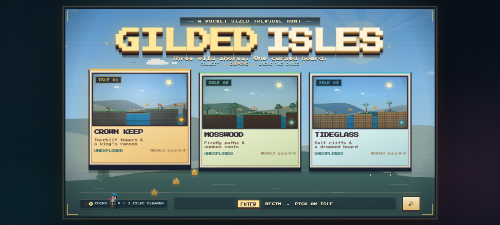
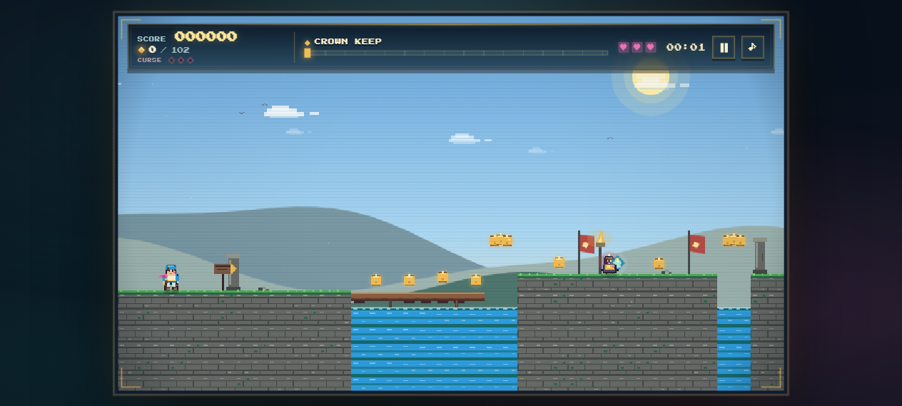
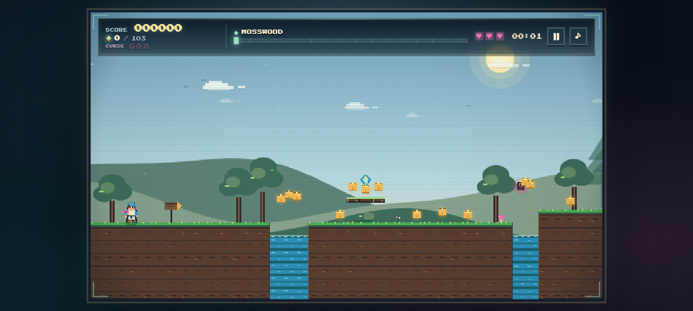
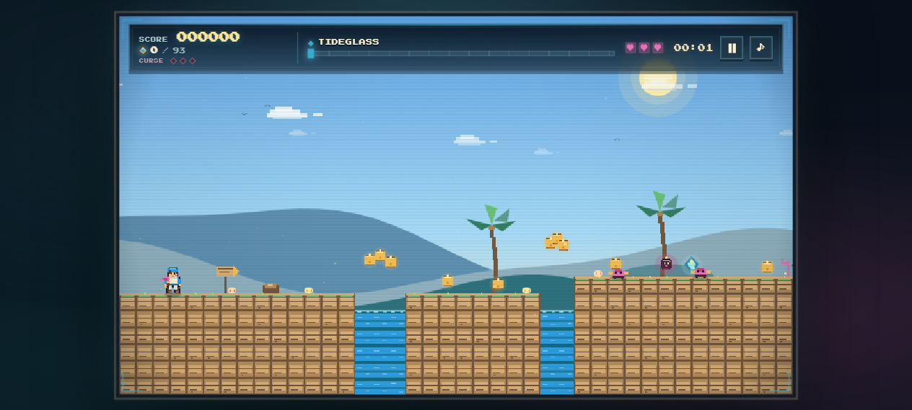
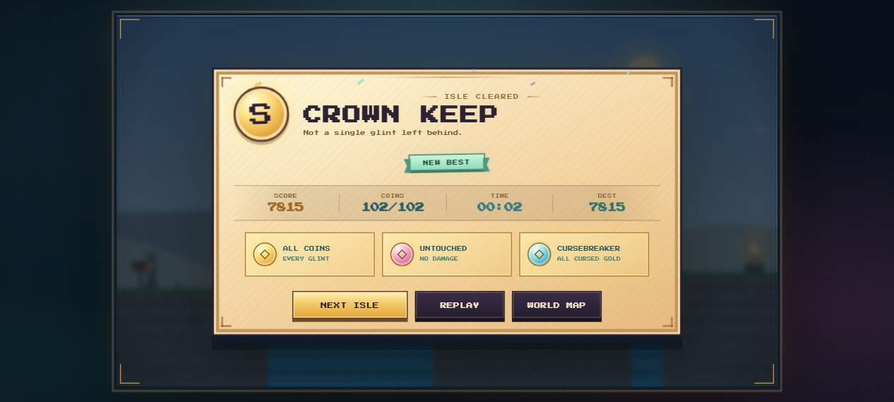
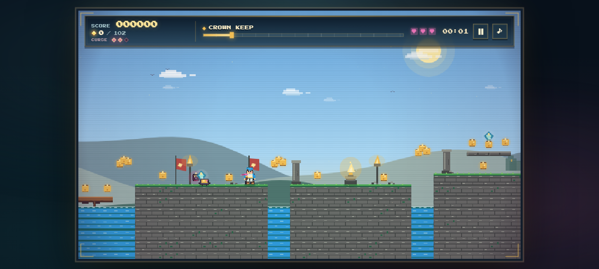
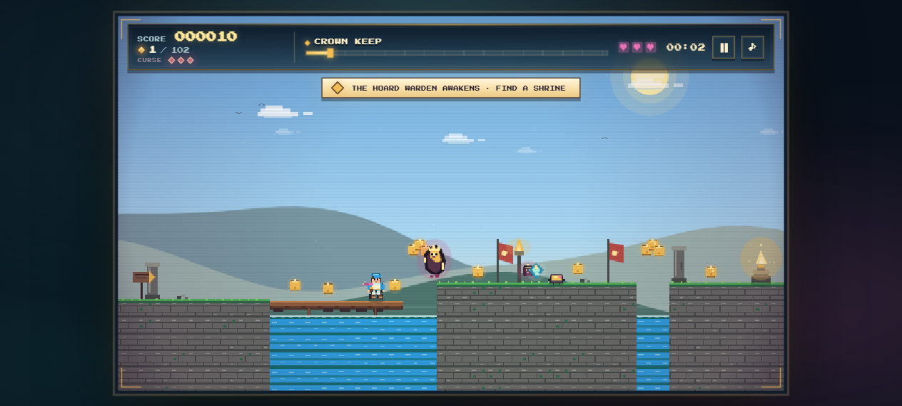

# GILDED ISLES — A Coin Collector's Tale

A polished, side-scrolling pixel-art platformer built from scratch for the web. Explore three wild shores, collect coins and gems, learn to chain combos, and reach the gate to claim your place among the great hoarders. The newest treasure is *cursed* — and it knows when you take it.

| Title | Crown Keep | Mosswood | Tideglass |
| --- | --- | --- | --- |
|  |  |  |  |



| Curse & shrines | The Hoard Warden |
| --- | --- |
|  |  |


## Realms

| Realm | Theme | Vibe |
| --- | --- | --- |
| **CROWN KEEP** | Castle | Torchlit towers, stonework, and a king's ransom. |
| **MOSSWOOD** | Forest | Firefly paths, mossy roots, and mushrooms. |
| **TIDEGLASS** | Sea | Salt cliffs, coral, and a drowned hoard. |

Each realm is procedurally generated from a fixed seed, so every playthrough feels hand-crafted without a build step.

## Run it

**Just open it.** Double-click `index.html` in the project root to launch the game. It will redirect to `src/index.html` automatically. You can also open `src/index.html` directly.

- No build step, no bundler, no server required.
- Works from `file://` — saves and audio fall back gracefully when blocked by the browser.
- Uses a locally bundled pixel font where possible, with a monospace fallback.

## Controls

| Input | Action |
| --- | --- |
| `A` / `D` or `←` / `→` | Move |
| `W` / `↑` or `Space` | Jump (coyote time and jump buffer) |
| `Shift` | Sprint |
| `P` / `Esc` | Pause / Resume |
| `M` | Mute / unmute |
| `Enter` | Start / confirm on menus |
| **Touch** | On-screen left/right/jump/sprint buttons appear on touch devices |
| **Gamepad** | D-pad/left stick, `A/Cross` (jump), `B/Circle` or shoulder (sprint) — basic support |

## Gameplay

- **Collect** gold coins (`+10`) and rare gems (`+50`). Gems sit high on floating ledges.
- **Cursed gold** (`+75`) hides among the ordinary coins. It fills the three-notch **curse meter** in the HUD. Three notches wake the **Hoard Warden**, a gold-masked spirit that phases through the level and hunts you down.
- **Shrines** are small stone altars with a gold flame. When the curse meter is full, step close to spend the shrine, banish the Warden, and restore a heart. Passing with a partial curse does not waste the shrine. Each shrine can be used once.
- **Banish the Warden** by stomping it from above for a big bonus, or let it catch you: it takes its toll, but also lifts the curse so you get another chance.
- **Combo** chain collections within 2.65 seconds to multiply your score up to `x5` (at 15 pickups).
- **Stomp** enemies by jumping on them for a small bonus.
- **Checkpoints** save your position; fall in water, into spikes, or off the world and you'll respawn at the last checkpoint (or the start). Falling also breaks your curse.
- **Reach the gate** at the end of each isle to finish the level. Collect everything for a **perfection bonus**, and collect every cursed coin for a **cursebreaker bonus**.
- **Earn medals** — **ALL COINS**, **UNTOUCHED**, and **CURSEBREAKER** — saved per realm and shown on the title cards. The completion screen shows which medals you earned on that run.
- **Track your progress** — best time, best score, medals, and cleared status are saved per realm in `localStorage`.

## Project structure

```
index.html              Root launcher (redirects to src/index.html)
src/
  index.html            Game page, screens, HUD, and touch controls
  css/style.css         Core pixel UI, parchment menus, responsive stage scaling
  css/polish.css        Presentation layer: gilded frame, title cards, HUD, medals
  fonts/                Locally bundled Press Start 2P font
  js/util.js            Helpers, RNG, AABB, localStorage
  js/audio.js           WebAudio chiptune music/SFX with mute
  js/world.js           Realm definitions and seeded platformer level generation
  js/render.js          Procedural pixel rendering, palettes, particles, title/cards
  js/game.js            Game loop, physics, input, saves, progression, debug API
screenshots/new/        Preview screenshots
legacy/coin-quest-topdown/  The previous top-down build, archived intact
inspo for the game UI/      Inspiration images
```

## Presentation

The interface leans into the treasure-hunt theme without changing the controls or the pixel-art world:

- The title screen has realm-tinted collectible cards, animated medal pips, a gold-foil logo sheen, and a live realm accent that follows the selected isle.
- Each run opens with a short **isle intro banner** naming the next shore before the HUD takes over.
- The in-game HUD uses a gilded glass frame, a segmented route track, docketed curse notches, and crystal hearts.
- Completion medals are illustrated medallions with earned and locked states; the results sheet adds a stamped rank, ribbon, and small confetti flourish.
- `prefers-reduced-motion` disables the nonessential sheen, pulse, and reveal animations.

## Notes

- **Internal resolution**: `640 × 360` with nearest-neighbor scaling and automatic letterbox fitting.
- **Physics**: gravity, sprint, coyote time, jump buffer, one-way floating platforms, water/spike hazards.
- **Gems are tricky** — they're placed on optional ledges to reward exploration.
- **Level layout**: shelves and water-cut gaps are generated so most routes remain fair for a running jump, with checkpoints placed roughly a third and two-thirds through each realm.
- **Debug (dev)**: `window.__GILDED__` exposes `start(id)`, `pause()`, `resume()`, `finish()`, `collectAll()`, `teleport(x,y)`, `invincible(sec)`, `checkpoints()`, `shrines()`, `cursed()`, `setCurse(n)`, `cleanse()`, `warden()`, `enemies()`, `state()`, `setTest(v)` for quick inspection in the console.
- **Focus behavior**: the game pauses when the tab loses focus (unless `?test=1` is used).
