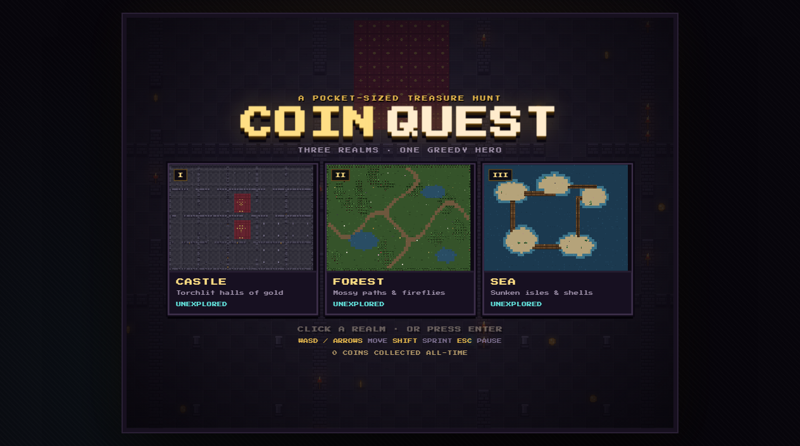
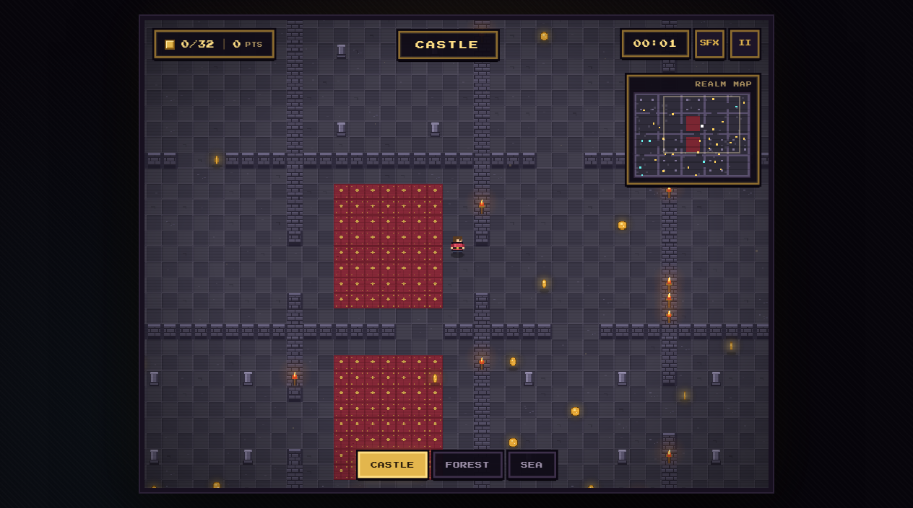
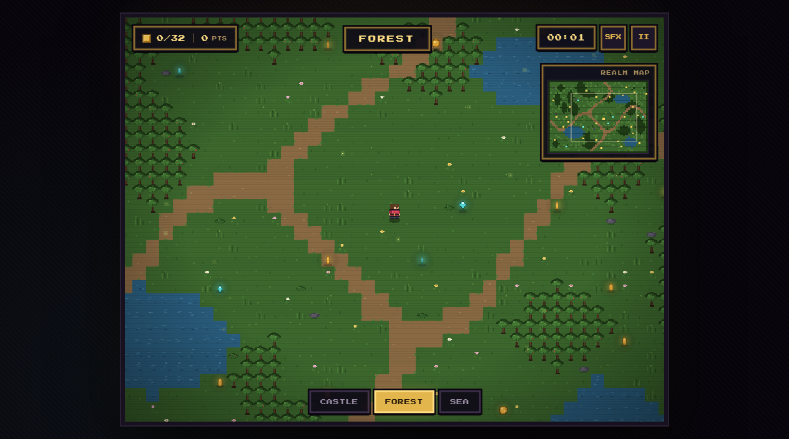
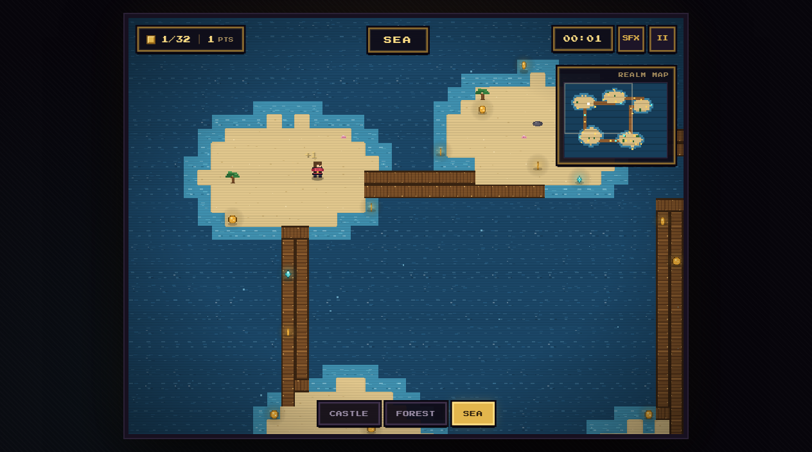

# Coin Quest — Pixel Coin Collector

A tiny pixel-art treasure hunt across three handcrafted-feeling realms.

- **Castle** — torchlit stone halls, red carpets and pillars
- **Forest** — winding dirt paths, dense trees, ponds and fireflies
- **Sea** — sandy islands linked by plank bridges, palms and shimmering water

Collect **32 treasures** in each realm, chain pickups for a combo multiplier, and race your own best score / fastest clear. Every map has a full minimap and a distinct procedural pixel-art tileset.

## Run it

Double-click **`index.html`** in the project root (it redirects to the game), or open **`src/index.html`** directly.

No build step, no dependencies, no server required. Classic scripts are used so the game also works from `file://`.

> The pixel font is loaded from Google Fonts. Without internet it falls back to a monospace font; gameplay is unchanged.

## Screenshots

| Title | Castle | Forest | Sea |
| --- | --- | --- | --- |
|  |  |  |  |

## Controls

| Key | Action |
| --- | --- |
| `WASD` / Arrow keys | Move |
| `Shift` | Sprint |
| `Esc` / `P` | Pause |
| `M` | Mute / unmute |
| `Enter` | Start / next realm / resume |

Touch devices get an on-screen D-pad in landscape.

## Scoring

- Gold coin = **1 point**
- Gem = **5 points**
- Chain treasures within **3.2 seconds** to build a combo up to **x5**

Your best score and fastest clear are saved per realm in `localStorage`. Total treasure collected is saved too. Use the pause menu to restart a realm or return to the title screen.

## Project structure

```
index.html              quick launcher / redirect
src/
  index.html            game page
  css/style.css         pixel UI, title, HUD, modals, touch controls
  js/rng.js             deterministic seeded RNG
  js/render.js          procedural tile art + minimap renderer
  js/maps.js            castle / forest / sea generation + collectible placement
  js/entities.js        player sprite + spinning coins/gems
  js/audio.js           WebAudio chiptune sound effects
  js/game.js            game loop, camera, HUD, screens, scoring, saves
  assets/               reserved for future sprite/tileset files
screenshots/            captured previews of each screen
inspo for the game UI/  inspiration images
```

## Notes

- Maps are generated with fixed seeds, so each realm is the same every visit.
- Coins are only placed on the largest reachable connected region and are verified reachable from the spawn point.
- High scores live under the `cq_bests` key, total coins under `cq_total`, and sound preference under `cq_sound`.
- A small `window.CQGame.snapshot()` debug helper and `window.CQGame.warp(x, y)` are available in the browser console if you want to poke around.
